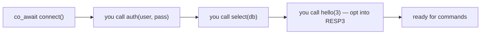
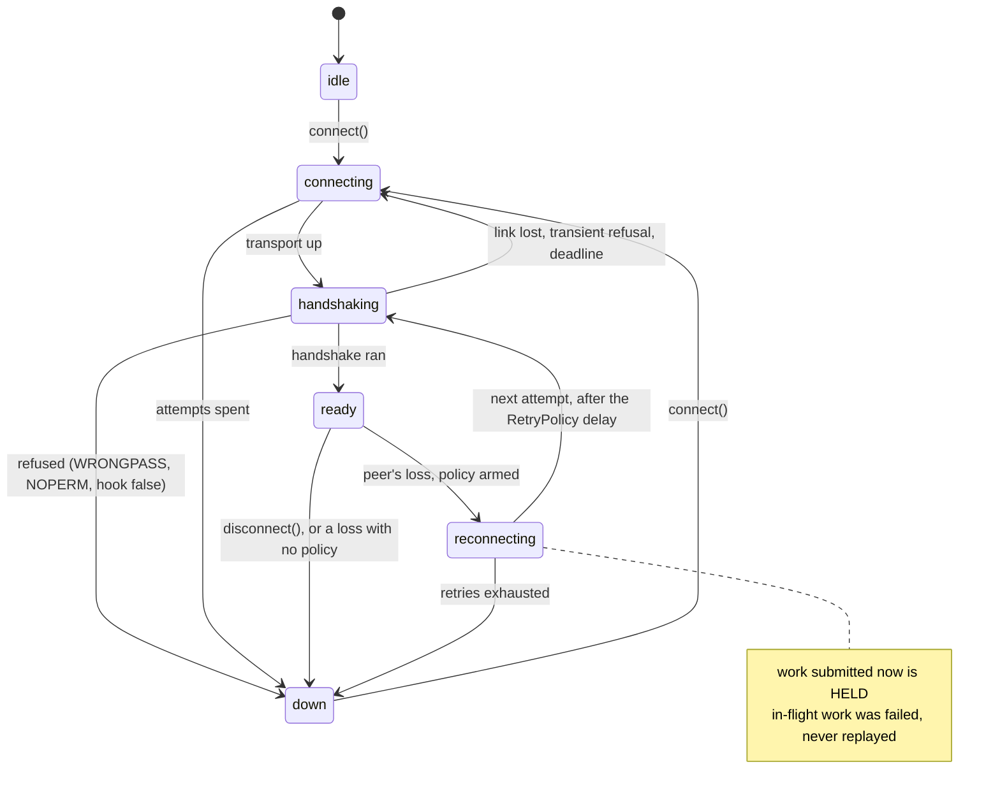

# Connecting to Redis

> **Audience:** Adopter · **Status:** stable · **Verified-against:** qbm-redis @ qb 3.3.0 (C++20 default, C++23
> supported)

How `qb::redis::tcp::client` (and, under `QB_HAS_SSL`, `qb::redis::tcp::ssl::client`) parses a connection URI, opens an
asynchronous socket, optionally authenticates and upgrades to TLS, enforces connect and command deadlines as
`qb::duration`, and what happens to in-flight work when the link drops.

**Prerequisites:** [../README.md](../README.md) (install, `qb_load_modules`, `qbm::redis`) — **See also:
** [actors.md](./actors.md), [error_handling.md](./error_handling.md), [commands_overview.md](./commands_overview.md), [pipeline_and_await.md](./pipeline_and_await.md), [subscription_commands.md](./subscription_commands.md)

---

## Summary

A Redis client is a single object. Construct it (optionally with a URI), then start the handshake with `connect()`,
which returns an **awaiter** — there is no blocking `bool connect()`. Drive the awaiter with `co_await` inside a
coroutine, or with `qb::io::async::run_sync(...)` from synchronous code; `connect(callback, ...)` overloads exist for
callback-style code. The awaiter resolves to `true` once the socket is open and the RESP protocol is attached, `false`
on failure or timeout.

The client opens the connection but does **not** authenticate, select a database, or switch to RESP3 for you. Those are
ordinary commands you issue after `connect()` resolves: `auth(...)`, `select(...)`, `hello(3)`.



None of these are automatic, and **none are replayed across an auto-reconnect** — re-run them in your own post-reconnect flow. Connect timeouts, the
`RetryPolicy` backoff delays, and the optional command-deadline watchdog are all expressed in **`qb::duration`** (
`std::chrono`-backed). Redis command *arguments* that carry time (for example `EXPIRE` seconds) keep their native
units — that boundary is covered in [commands_overview.md](./commands_overview.md), not here.

```cpp
#include <qbm/redis/redis.h>
#include <qb/io/async.h>
#include <qb/io/async/coroutine.h>

qb::io::async::task<void> example() {
    qb::redis::tcp::client redis{qb::io::uri{"tcp://localhost:6379"}};

    if (!co_await redis.connect()) {
        qb::io::cerr() << "connection failed" << std::endl;
        co_return;
    }

    auto pong = co_await redis.ping();
    if (pong)                                  // Reply<T> is contextually bool
        qb::io::cout() << pong.result() << std::endl; // "PONG"
}
```

<!-- src: qbm/redis/tests/integration/connection/connection-commands.cpp:108-119 -->

> The client is **not thread-safe.** Use one client from a single I/O thread / strand (one concurrent accessor). The
> reply queue and outbound pipe are unsynchronized.

---

## Concepts

### Client types and transports

The client is a compiled library (`qbm::redis`), not header-only. Link it with the standard module integration, then
include the umbrella header:

```cmake
add_subdirectory(qb)
qb_load_modules("${CMAKE_CURRENT_SOURCE_DIR}/qbm")
target_link_libraries(your_app PRIVATE qbm::redis)
```

```cpp
#include <qbm/redis/redis.h>   // namespace qb::redis
```

Everything lives in `namespace qb::redis`. The transport-bound aliases you instantiate are:

| Alias                                         | Transport     | Notes                                                                          |
|-----------------------------------------------|---------------|--------------------------------------------------------------------------------|
| `qb::redis::tcp::client`                      | plaintext TCP | the common case                                                                |
| `qb::redis::tcp::ssl::client`                 | TLS (`stcp`)  | compiled only when `QB_HAS_SSL` is defined                                     |
| `qb::redis::tcp::pipeline`                    | plaintext TCP | named callback-pipelining wrapper                                              |
| `qb::redis::tcp::cb_consumer` / `co_consumer` | plaintext TCP | pub/sub consumers (see [subscription_commands.md](./subscription_commands.md)) |

<!-- src: qbm/redis/src/qbm/redis/redis.h:4007-4033 -->

`qb::redis::tcp::client` is the alias for `qb::redis::detail::Redis<qb::io::transport::tcp>`; `database<QB_IO_>` is the
generic template behind it. All the command mixins (`connection_commands`, `string_commands`, …) are inherited by this
one class, so a connected client exposes the entire command surface directly.

### Connection URIs

You construct a client from a `qb::io::uri`, or pass one to `connect()` / `set_uri()` later. The scheme selects the
transport behavior:

| Scheme                       | Meaning                                      |
|------------------------------|----------------------------------------------|
| `tcp://host:port`            | plaintext TCP (e.g. `tcp://127.0.0.1:6379`)  |
| `redis://host:port`          | alias for plaintext TCP                      |
| `rediss://host:port`         | TLS — use with `qb::redis::tcp::ssl::client` |
| `unix:///path/to/redis.sock` | Unix domain socket                           |

The URI carries only the endpoint. Credentials and database selection are **not** taken from the URI; issue `auth(...)`
and `select(...)` explicitly after connecting (see below).

The POSIX system test `qbm-redis-test-system-unix-socket-connection` covers RESP2/RESP3 PING,
binary SET/GET values and failure on a missing socket. `REDIS_UNIX_SOCKET` must name an absolute
socket path: an unset variable skips the test, while an explicitly configured but unavailable
socket fails. The Linux module and superproject suites provide an owned Redis instance and require
zero skipped tests. Windows excludes this POSIX transport test.

To run it against a disposable local Redis without touching a system service, from this module:

```sh
python3 tests/shared/run-with-unix-redis.py --redis-server "$(command -v redis-server)" -- \
  ctest --test-dir /path/to/build -R '^qbm-redis-test-system-unix-socket-connection$' --output-on-failure
```

The launcher binds no TCP port, verifies PING/PONG, supplies the socket path only to its child,
and stops its own server on success, failure or interruption. An existing dedicated instance can
instead be selected by setting `REDIS_UNIX_SOCKET` before running CTest directly.

### `connect()` is an awaiter, not a blocking call

`connect()` returns a `connect_awaiter`. It does nothing until you `co_await` it (or hand it to a runner). There are
four coroutine overloads and two callback overloads:

```cpp
// Coroutine form — qbm/redis/src/qbm/redis/redis.h:1115-1134
connect_awaiter connect();                                   // use the stored URI, 3s default timeout
connect_awaiter connect(qb::io::uri uri);                    // set + use this URI
connect_awaiter connect(qb::duration timeout);              // stored URI, custom timeout
connect_awaiter connect(qb::io::uri uri, qb::duration timeout);

// Callback form — qbm/redis/src/qbm/redis/redis.h:1173-1194
template <std::invocable<bool> Func>
void connect(Func &&func, qb::io::uri uri, qb::duration timeout = std::chrono::seconds(3));
template <std::invocable<bool> Func>
void connect(Func &&func, qb::duration timeout = std::chrono::seconds(3));
```

<!-- src: qbm/redis/src/qbm/redis/redis.h:1066-1134,1173-1194 -->

The default connect timeout is **3 seconds** (`qb::duration`), and it bounds the connection's handshake too. The
awaiter resolves to `true` only once that handshake ran -- the client is **ready**, which is what `is_connected()`
reports; a failed transport, a refused or timed-out handshake, or a `disconnect()` meanwhile resolves to `false`, and a
`connect()` while a connection, a handshake or a reconnection run is already in progress resolves `false` at once.
There is no exception on a failed connect — check the boolean. Commands submitted before it resolves are not lost:
they are **held**, and leave after the handshake (below).

### Time units: everything on this page is `qb::duration`

The framework's canonical time type is `qb::duration` (a `std::chrono::nanoseconds` span). Every timing knob involved in
*connecting* takes a `qb::duration`, which any `std::chrono` literal converts to implicitly:

- the `connect()` timeout (default `3s`);
- every delay in `RetryPolicy` — `initial_delay` (default `100ms`), `max_delay` (default `30s`), `connect_timeout` (
  default zero: each attempt takes the 3 s of `connect()`), and the `next_delay` passed to the `on_retry` callback;
- the optional `set_command_timeout(...)` deadline (default `qb::duration::zero()` = disabled).

> The retired aliases `qb::Duration`, `qb::Timestamp`, and `qb::TimePoint` (and the helpers `to_timestamp(...)` /
`to_time_point(...)`) are **removed** — never pass them here. Use `qb::duration` and `std::chrono` literals.

Note the boundary: this is distinct from Redis *command arguments* that carry time. `EXPIRE` takes seconds and `PEXPIRE`
takes milliseconds, exposed through native-unit `std::chrono` overloads on the command APIs; those are intentionally *
*not** `qb::duration`. See [commands_overview.md](./commands_overview.md). Reply TTL values come back as plain integers.

The connection lifecycle -- the states `state()` reports, qb-io's `qb::io::connection_state` -- including how
`RetryPolicy` drives the reconnection run:



<!-- src: qb/src/qb/io/reconnect.h:63-80 -->

---

## Connecting

### Inside an actor (the usual case)

The handshake belongs in `onInit()`, where the actor is not started until the awaiter resolves — so nothing is served
against a half-open connection, and a failed connect fails the init:

```cpp
// In a qb::Actor. See actors.md for the surrounding class and its shutdown order.
qb::io::async::task<bool> onInit() override {
    registerEvent<qb::KillEvent>(*this);
    _redis = std::make_shared<qb::redis::tcp::client>(qb::io::uri{"tcp://localhost:6379"});
    _redis->set_command_timeout(std::chrono::seconds(5));
    co_return co_await _redis->connect(std::chrono::seconds(2));
}
```

Nothing else on this page changes inside an actor — except that the `run_sync` form below stops the `VirtualCore`
rather than your own thread, and nothing reports it ([actors.md](./actors.md#bridging-to-synchronous-code)).

### Coroutine connect (the idiomatic form)

```cpp
#include <qbm/redis/redis.h>
#include <qb/io/async.h>
#include <qb/io/async/coroutine.h>

using namespace std::chrono_literals;

qb::io::async::task<void> open_and_use() {
    qb::redis::tcp::client redis{qb::io::uri{"tcp://localhost:6379"}};

    if (!co_await redis.connect(2s))           // 2-second connect deadline
        co_return;

    // Optional: opt into RESP3 (server replies in RESP2 until you ask).
    co_await redis.hello(3);

    auto r = co_await redis.command<std::string>("GET", "key");
    if (r)
        qb::io::cout() << r.value() << std::endl;
}
```

<!-- src: qbm/redis/tests/integration/connection/connection-commands.cpp -->

### Synchronous connect (a `main()`, a test, a bootstrap script)

From non-coroutine code — where the thread you are about to block is your own — drive the awaiter with
`qb::io::async::run_sync`, which pumps the event loop until the awaiter resolves:

```cpp
#include <qbm/redis/redis.h>
#include <qb/io/async.h>

qb::io::async::init();

auto client = std::make_unique<qb::redis::tcp::client>(qb::io::uri{"tcp://localhost:6379"});
if (!qb::io::async::run_sync(client->connect()))
    throw std::runtime_error("connection failed");
```

<!-- src: qbm/redis/tests/system/connection/reconnect-lifetime-uaf.cpp:118-119 -->

### Callback connect

```cpp
qb::io::async::init();

qb::redis::tcp::client redis{qb::io::uri{"tcp://localhost:6379"}};
redis.connect([&redis](bool connected) {
    if (!connected) return;
    redis.ping([](qb::redis::Reply<std::string> &&reply) {
        if (reply) { /* "PONG" */ }
    });
});
```

<!-- src: qbm/redis/src/qbm/redis/redis.h:1173-1194 -->

`set_uri(uri)` updates the stored endpoint without connecting; a later argument-less `connect()` uses it. `uri()`
returns the current endpoint. `is_connected()` is `true` while the client is ready -- connected and its handshake run
(`state() == qb::io::connection_state::ready`).

---

## The handshake: authentication, database, protocol

What a session needs -- credentials, a database, RESP3, anything else the server must know first -- is **configured**
on the client, not sent after `connect()`: the client runs it as the **handshake** of every connection, the first one
included and every reconnection after it, before any command you submitted leaves. Configure it before `connect()`:

```cpp
qb::redis::tcp::client redis{qb::io::uri{"tcp://localhost:6379"}};
redis.with_resp3()                       // HELLO 3 -- which then also carries the credentials
     .with_auth("app_user", "s3cr3t")    // ACL user (Redis 6+); with_auth("s3cr3t") for the default user
     .with_select(2);                    // SELECT 2, after authentication
redis.set_handshake([](qb::redis::tcp::client::handshake_client &hs) -> qb::io::async::task<bool> {
    auto named = co_await hs.command<std::string>("CLIENT", "SETNAME", "billing-worker");
    co_return named.ok();                // false refuses the connection
});
if (!co_await redis.connect())           // true once all of the above ran
    co_return;
```

<!-- src: qbm/redis/src/qbm/redis/redis.h:782-849 (the handshake, in order: HELLO 3 or AUTH, SELECT, the hook, the replay), 1259-1293 (set_handshake, with_auth, with_select, with_resp3) -->

The order is fixed: HELLO 3 (with `AUTH user password` when credentials are set) or AUTH alone, then SELECT, then the
hook. The hook writes through the `handshake_client&` it is given, never
through the client: the client **holds** every command until it is ready, so a command the hook sent through it would
wait for the end of the hook that sent it, and a handle that wrote whenever asked would let another coroutine slip a
command past the gate while the hook is suspended. A copy of the handle kept past the hook writes nothing: its commands
fail with `"handshake over"`.

**A refused handshake is terminal and visible.** An error reply -- `WRONGPASS`, `NOPERM`, a database out of range -- or
the hook returning `false` (or throwing) leaves the client `down` with `down_reason() ==
qb::io::down_reason::handshake_refused`; no reconnection run retries it, since retrying cannot heal it and could lock
an ACL user out. Held commands fail with `"handshake refused: <the server's text>"`. What a retry CAN heal is one more
attempt: a `LOADING`, `BUSY`, `TRYAGAIN` or `MASTERDOWN` reply, a link lost during the handshake, a handshake past the
attempt's connect timeout.

`auth(...)`, `select(index)` and `swapdb(a, b)` are still commands you may send yourself, each yielding
`Reply<status>`; a rejected credential then resolves with `ok() == false` and the server message in `error()` (for
example `WRONGPASS`), without closing the connection. But what you send by hand belongs to one connection only: after a
reconnection the server sees a fresh RESP2 session on database 0, unauthenticated, unless the handshake carries it.
Credentials are stored on the client only through `with_auth()`. The dedicated error type is `qb::redis::AuthError`
(see [error_handling.md](./error_handling.md)).

---

## TLS

For an encrypted link, use the SSL alias and a `rediss://` URI. The SSL types are compiled only when the framework is
built with `QB_HAS_SSL`:

```cpp
#ifdef QB_HAS_SSL
qb::redis::tcp::ssl::client redis{qb::io::uri{"rediss://redis.example.com:6379"}};

// Server certificate + hostname verification is ON by default. Disable it
// ONLY for a trusted/self-signed endpoint, and ONLY before connect().
// redis.set_verify_peer(false);

if (!co_await redis.connect())
    co_return;
#endif
```

<!-- src: qbm/redis/src/qbm/redis/redis.h:1205-1232 -->

`set_verify_peer(bool)` toggles TLS chain + hostname verification; it **defaults to `true`** and must be set before
`connect()`. `verify_peer()` reads the current setting. For a **private CA**, call `set_ssl_root_cert(path)` (a PEM
file or directory trusted in addition to the system store, so `verify_peer(true)` validates an internally-issued
certificate); for **mutual TLS**, call `set_ssl_client_certificate(cert, key)` to present a client certificate. All
apply to the `stcp` (TLS) transport used by `rediss://`, must be set before `connect()`, and have no effect on
plaintext clients; a bad CA/cert/key path fails the connect **closed**.

---

## Connect retry and auto-reconnect

There are two related but distinct mechanisms, both driven by `RetryPolicy`.

### `RetryPolicy` — backoff configuration

`qb::redis::RetryPolicy` is qb-io's `qb::io::reconnect_policy` -- the one reconnection policy qbm-redis, qbm-pgsql
and the qbm-http clients share (`qb::http::RetryPolicy` is the same type):

```cpp
using RetryPolicy = qb::io::reconnect_policy;

struct reconnect_policy {                    // qb/io/reconnect.h
    int          max_attempts   = -1;        // -1 = unlimited
    qb::duration initial_delay  {100ms};
    qb::duration max_delay      {30s};
    double       multiplier     = 2.0;       // below 1 reads as 1
    bool         jitter         = true;
    qb::duration connect_timeout{};          // per-attempt connect deadline; zero = the 3 s of connect()
    std::function<void(int attempt, qb::duration next_delay)> on_retry;
};
```

<!-- src: qbm/redis/src/qbm/redis/redis.h:231; qb/src/qb/io/reconnect.h:218-228 -->

Every field has a fluent setter that returns `*this`, so you build a policy inline. **All three time fields
are `qb::duration`,** and the `on_retry` callback receives the next delay as a `qb::duration`:

```cpp
auto policy = qb::redis::RetryPolicy{}
    .with_max_attempts(5)
    .with_initial_delay(50ms)
    .with_max_delay(2s)
    .with_multiplier(2.0)
    .with_jitter(true)
    .with_connect_timeout(2s)
    .with_on_retry([](int attempt, qb::duration next_delay) {
        qb::io::cout() << "retry " << attempt << " in "
                       << std::chrono::duration_cast<std::chrono::milliseconds>(next_delay).count()
                       << "ms" << std::endl;
    });
```

<!-- src: qbm/redis/tests/integration/connection/connection-commands.cpp:311-325 -->

The backoff is exponential: the delay starts at `initial_delay`, multiplies by `multiplier` after each failed attempt,
and is capped at `max_delay`. With `jitter` on, each delay is randomized by ±25% to avoid thundering herds. The math
runs in integer milliseconds and is assigned back into `qb::duration` -- the policy's own `next_delay(attempt)`, so the
waits are the ones the HTTP/2 client's run takes. An `initial_delay` above `max_delay` waits `max_delay`, and a
`multiplier` below 1 reads as 1. `max_attempts < 0` means retry forever; with `max_attempts == n`, retries stop after
`n` failed attempts.

### `connect_with_retry` — one-shot retried connect

`connect_with_retry(...)` is a coroutine that drives the policy yourself. It returns `qb::io::async::task<bool>` and
resolves once a connect succeeds or the attempts are exhausted:

```cpp
qb::redis::tcp::client client{qb::io::uri{"tcp://localhost:6379"}};

bool connected = co_await client.connect_with_retry(
    qb::redis::RetryPolicy{}
        .with_max_attempts(5)
        .with_initial_delay(10ms)
        .with_connect_timeout(2s));

// URI overload also exists:
// co_await client.connect_with_retry(qb::io::uri{"tcp://..."}, policy);
```

<!-- src: qbm/redis/tests/integration/connection/connection-commands.cpp:276-340 -->

### `enable_auto_reconnect` — re-dial on a peer's loss

`enable_auto_reconnect(policy)` arms a **reconnection run** for the next time the connection is lost the way a client
recovers from: the peer closed or reset it, sent a frame the parser refused, or stopped answering (the command
watchdog's own drop). The connector then runs the policy's attempts -- each a transport connect and the handshake -- on a
**detached** coroutine of the same loop; `disable_auto_reconnect()` disarms the next one. **An explicit `disconnect()`
never starts a run**, policy or not: it is terminal, as on the qbm-http clients.

```cpp
qb::redis::tcp::client client{qb::io::uri{"tcp://localhost:6379"}};
co_await client.connect();

client.enable_auto_reconnect(qb::redis::RetryPolicy{}
    .with_max_attempts(3)
    .with_initial_delay(50ms)
    .with_connect_timeout(2s)
    .with_jitter(false));

// Some time later the server restarts or drops the client…
// is_reconnecting() is true while the run lasts; on_connected() fires and is_connected()
// is true again once an attempt's handshake ran. A command submitted meanwhile is held.
```

<!-- src: qbm/redis/tests/integration/connection/reconnect-resilience.cpp:198-219 -->

`is_reconnecting()` is `true` for the lifetime of the run; `is_connected()` flips back to `true` when an attempt's
handshake ran. A run that spends its `max_attempts` leaves the client `down` with `retries_exhausted`. The run uses the
same I/O loop — there is no extra thread.

A run's first attempt is immediate -- `initial_delay` is the wait before the second -- so a run can be over a loop pass
or two after the loss: a client with nothing to handshake (no `with_resp3()`, `with_auth()`, `with_select()`,
`set_handshake()` hook or subscription to replay) is ready again as soon as the transport reconnects. Observe a run
through `on_disconnected` and `on_connected`, or `stats().reconnects`, never by polling `is_reconnecting()` after the
fact: a poll sees where the client stands when it looks, not what happened before it.
<!-- src: qb/src/qb/io/reconnect.h:218-228 -->

`state()` and `down_reason()` say where the client stands at any moment, and three hooks report the transitions, each
empty until set and read only on those transitions: `on_connected()` each time the client becomes ready,
`on_disconnected(qb::io::down_reason)` once for every ready connection lost -- with its cause, `user`, `peer` or
`protocol`; the two strictly alternate -- and `on_down(qb::io::down_reason)` when the client reaches `down`.
`on_disconnected` runs after the work in flight failed and before the connector decides whether to start the run: if it
throws, the connector logs the error and still checks the current policy, so a hook that calls
`disable_auto_reconnect()` prevents the run even if it later throws.
<!-- src: qbm/redis/src/qbm/redis/redis.h:615-677 (link-loss order, exception containment, reconnect decision), :3225-3249 (consumer pending-reply drain before notification) -->

> **Auto-reconnect replays the handshake, never a request.** Every reconnection runs the configured handshake --
> RESP3, credentials, database, the hook, and a consumer's CONFIRMED subscriptions -- before anything else, so nothing
> has to be redone by hand. In-flight commands are **not** replayed: they were failed at the loss (next section). A
> consumer marks the hole: one gap marker (`message::is_gap()`) before the new connection's first message.

---

## What happens to in-flight work when the link drops (fail-queued)

The client pipelines: it sends a command's bytes and queues its reply handler in FIFO order. When the connection drops —
a peer close, an explicit `disconnect()`, or a tripped command deadline — every queued handler is **failed immediately
**, in order, before any reconnection begins:

- The pending-reply queue is swapped out and drained. Each handler is invoked with the disconnect signal (a null reply),
  surfacing as `Reply{ ok = false, error = "disconnected" }`. A `co_await`-ing caller therefore *resumes* on disconnect
  with a failed `Reply<T>` — it does not hang.
- If the drop was caused by the command-deadline watchdog (below), the reason is `"command timed out"` instead, so
  callers can distinguish a dead peer from an ordinary close.
- Any open transaction / `MULTI` state is reset.

```cpp
auto r = co_await redis.command<std::string>("GET", "key");
if (!r) {
    // On a mid-flight disconnect this branch runs with
    // r.error() == "disconnected" (or "command timed out").
    qb::io::cerr() << "command failed: " << r.error() << std::endl;
}
```

<!-- src: qbm/redis/src/qbm/redis/redis.h:2025-2064 -->

The queue is swapped *before* the drain loop so that a failing handler may legitimately re-issue a command without
that brand-new command being failed by the same loop. Where it goes then depends on the state the client is in:

- **`connecting`, `handshaking`, `reconnecting` -- held.** The command is serialized apart and waits; once the client
  is ready it leaves, in submission order, after the handshake. It fails once with the reason if the client goes
  `down` instead (`"disconnected"`, `"reconnection attempts exhausted"`, `"handshake refused: …"`), or with
  `"command timed out"` once it waited `set_command_timeout()`.
- **`idle` or `down` -- failed.** Nothing will send it: it fails on the next loop pass with `"not connected"` or the
  down reason -- never inside the call, so a failure handler that submits again cannot recurse.

The bytes of the commands that never left go with their handlers: the connector empties its input and output buffers
*before* the drain, so a command serialized but not yet flushed cannot lead the next connection — its reply would be
handed to whichever command is then first in line, and the FIFO would stay off by one. Nothing reaches a new connection
before its handshake.

### `disconnect()`, `quit()`, and destruction

- **`disconnect()`** is terminal: the client is `down` with `down_reason::user`, and no reconnection run starts
  whatever the policy -- only a new `connect()` leaves `down`. It completes the teardown before it returns -- on the
  spot, without running the loop, so nothing else runs under the caller -- so every queued handler has been failed when
  `disconnect()` comes back, and a `connect()` issued right after cannot overtake it. A coroutine awaiting one of
  those commands resumes at the loop's next pass, as every completion does. Called from inside a reply handler, the
  teardown runs as soon as that handler returns. Called while connecting, handshaking or reconnecting, it abandons the
  attempt and fails what was held.
- **`quit()`** is the Redis `QUIT` command (a coroutine yielding `Reply<status>`): it asks the server to close the
  connection cleanly after replying.
- **Destruction** is RAII — when the client object is destroyed the connection is torn down. The connector holds a
  shared liveness token so a detached reconnect or timer that fires after destruction safely no-ops instead of touching
  freed memory.

---

## Command-deadline watchdog (optional)

`set_command_timeout(qb::duration)` arms an opt-in **connection-health watchdog** — disabled by default (
`qb::duration::zero()`). If no reply arrives within the window for a non-blocking in-flight command, the client drops
the whole connection; pending commands then fail with `"command timed out"`, and auto-reconnect resumes if armed: the
watchdog's drop is the client's own decision, a recoverable loss, not a `disconnect()`. The same timeout bounds how long
a command HELD while the client is not ready waits: past it, it fails with `"command timed out"`.

```cpp
redis.set_command_timeout(500ms);   // arm
// redis.command_timeout();         // current value; zero() == disabled
// redis.set_command_timeout(qb::duration::zero());  // disarm
```

<!-- src: qbm/redis/src/qbm/redis/redis.h:2411-2441 -->

This is **not a per-command timer.** A FIFO-pipelined protocol cannot fail one mid-queue command without desynchronizing
every later reply, so the only safe action on a stall is to drop the connection. Blocking commands (`BLPOP`, `WAIT`,
`XREAD`, …) suspend the deadline so their own server-side timeout governs instead — the watchdog never spuriously drops
a legitimately parked command.

---

## Observability: `stats()`, latency, `on_command_complete`

A client reports what it has done (Huly QB-134), in `qbm/redis/stats.h`. `stats()` returns a snapshot by value:
monotonic counts since the client was constructed -- two snapshots give a rate, and a reconnection resets nothing.
Every command is counted once, when it completes, whatever way: `commands`, of which `errors` did not succeed (the
server's error reply, or no answer) and `failed` got no answer at all; `held` counts those that waited for the client
to be ready; `by_family` splits `commands` by command group. `reconnects` counts the ready connections reached after a
lost one -- a `disconnect()` ends the session, so the `connect()` after it is not one. A consumer reports its stream:
`messages_received`, `messages_dropped` (a full `co_consumer` queue) and `gaps` (the markers it put in the stream).

Latency is opt-in. `set_latency_stats(true)` times every command from its send to its completion and records it in
its family's histogram; `latency(family)` returns that histogram, and p50 / p95 / p99 are its `percentile(0.50)`,
`percentile(0.95)`, `percentile(0.99)` -- the upper bound of the log2 bucket that holds the quantile. Off, the default,
the client reads no clock for it and holds no histogram.

`on_command_complete(hook)` hands the hook one `qb::redis::command_info` per completed command, before the command's
own callback: the verb, its family, the outcome (`ok`, `error`, `failed`), the error text, and the duration when
latency stats are on. The arguments are never reported -- they may carry credentials. Without a hook a completion
costs one predictable branch. The hook runs on the client's thread, inside its dispatch: it must not drive the
client, and its `std::string_view`s die with the call. To feed a metrics actor, push a copy:

```cpp
struct CommandDone : qb::Event {
    qb::redis::command_family  family;
    qb::redis::command_outcome outcome;
    qb::duration               took;
};

// in the actor that owns the client
_redis.set_latency_stats(true);
_redis.on_command_complete([this, metrics = _metrics_id](qb::redis::command_info const &info) {
    push<CommandDone>(metrics, info.family, info.outcome, info.duration); // copies, never the views
});
```

<!-- src: qbm/redis/src/qbm/redis/stats.h:489-503 (command_info), :562-573 (stats), :509-553 (latency_histogram); qbm/redis/src/qbm/redis/redis.h:2450-2493 (set_latency_stats, latency, on_command_complete), qbm/redis/src/qbm/redis/redis.h:1682-1754 (each command counted once, inline at the dispatch; latency and the hook out of line) -->

---


### Prometheus snapshot adapters

Explicitly include `<qbm/redis/metrics.h>`; on the client's owner thread:

```cpp
qb::metrics::snapshot snapshot;
const qb::metrics::label_set labels{{"connection", "cache"}, {"core", "1"}};
qb::metrics::describe(snapshot, client.stats(), labels);
if (client.latency_stats()) {
    for (std::size_t i = 0; i < qb::redis::command_families; ++i) {
        const auto family = static_cast<qb::redis::command_family>(i);
        qb::metrics::describe(snapshot, client.latency(family), family, labels);
    }
}
```
<!-- src: qbm/redis/src/qbm/redis/metrics.h:21,31 -->

The nine totals are exact `qb_redis_<field>_total` counters; the 21-family breakdown is
`qb_redis_commands_by_family_total{family}`. `failed` is a subset of `errors`, itself a
subset of `commands`: adding them double-counts failures. Latency produces
`qb_redis_command_duration_seconds`: 31 inclusive finite bounds `(2^(i+1)*1000 - 1)` ns
converted to seconds, then an unbounded `+Inf` bucket, covering all 32 stored buckets.
There is a count but no sum, because the client stores none. Do not export the empty
histograms returned while timing is off as if they were observations. Disabling timing
discards the distribution; it does not reset the lifetime command counters.

Neither adapter enables timing, installs a callback or accesses a client. Retain a registry
`source_handle` after its client member and remove it on the same core before client teardown.
Use stable connection/core labels; `family` is added by the adapter and `le` is reserved for
histograms. No Redis keys, credentials or user paths in labels.

## Pitfalls

- **`connect()` does nothing on its own.** It returns an awaiter. Forgetting to `co_await` it (or pass it to `run_sync`)
  leaves you disconnected with no error. There is no blocking `bool connect()`.
- **No exception on failed connect or rejected auth.** `connect()` resolves to `false`; `auth()` resolves with
  `ok() == false`. Always check the boolean / `Reply` before issuing further commands.
- **Configure the session, do not send it.** `hello(3)`, `auth` and `select` sent by hand are lost at the next
  reconnection; `with_resp3()`, `with_auth()`, `with_select()` and `set_handshake()` are replayed on every connection.
  Credentials are stored only through `with_auth()`. A consumer replays the subscriptions the server confirmed.
- **`disconnect()` is terminal.** It never starts a reconnection run; `connect()` again.
- **In-flight commands are dropped, not replayed.** On disconnect, every queued command fails with `"disconnected"` (or
  `"command timed out"`). A `co_await` resumes with a failed reply rather than hanging, but the work is gone — re-issue
  idempotent commands yourself.
- **`set_verify_peer` only matters before `connect()`** and only on the `rediss://` / `ssl::client` path. Setting it
  after the handshake has no effect; disabling it on a plaintext client is meaningless.
- **The client is single-threaded.** Sharing one client across threads corrupts the reply queue. Use one client per I/O
  thread / strand.
- **Don't reach for `qb::Duration` / `qb::Timestamp`.** They are retired. All connect, retry, and command-deadline
  timings are `qb::duration`; pass `std::chrono` literals like `2s` or `500ms`.
- **Command-deadline is connection-wide.** `set_command_timeout` drops the whole connection on a stall — it is a
  watchdog, not a way to bound a single slow command.

---

## See also

- [actors.md](./actors.md) — the client inside a `qb::Actor`: `onInit()`, `spawn`, cancellation, shutdown order
- [error_handling.md](./error_handling.md) — `Reply<T>`, `ConnectionError`, `AuthError`, `TimeoutError`, the disconnect
  signal
- [commands_overview.md](./commands_overview.md) — the coroutine/callback dual API and the native time-unit boundary for
  command arguments
- [pipeline_and_await.md](./pipeline_and_await.md) — pipelining and `await()` draining for the callback API
- [subscription_commands.md](./subscription_commands.md) — pub/sub consumers and re-subscription after reconnect
- [../README.md](../README.md) — install, `qb_load_modules`, `qbm::redis`, quick start
