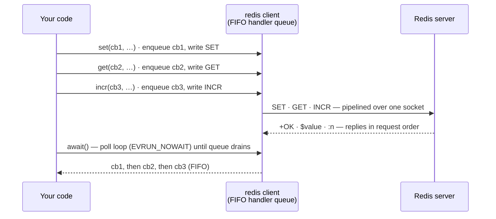

# Pipelining and `await()`

> **Audience:** Adopter · **Status:** stable · **Verified-against:** qbm-redis @ qb 3.3.0 (C++20 default, C++23
> supported)

How the client pipelines callback commands over a single connection, how `await()` drains pending replies without
blocking the kernel, and how the `qb::redis::tcp::pipeline` helper wraps the same mechanism.

**Prerequisites:** [connection.md](./connection.md) (you need a connected
client), [commands_overview.md](./commands_overview.md) (coroutine vs. callback forms) — **See also:
** [error_handling.md](./error_handling.md), [transaction_commands.md](./transaction_commands.md), [subscription_commands.md](./subscription_commands.md)

**Include:** `#include <qbm/redis/redis.h>` — every type below lives in namespace `qb::redis`.

`qbm-redis` is a compiled qb module (`qbm::redis`); pull it in with `add_subdirectory(qb)` →
`qb_load_modules("<path>/qbm")` → `target_link_libraries(app PRIVATE qbm::redis)`. The pipelining surface is template
code in `<qbm/redis/redis.h>`; link the target rather than adding the include directory by hand.

---

## Summary

Pipelining is a property of the client, not a separate object. Every callback command — `redis.set(cb, …)`,
`redis.get(cb, …)`, or the low-level `redis.command<Ret>(cb, "SET", …)` — pushes one reply handler onto a FIFO queue and
writes one RESP request to the outbound pipe, in call order (`redis.h:2370-2396`). Redis answers in request order, so the
queue stays positionally consistent. Issue several commands back-to-back without waiting, then call `await()` once to
run the loop until every handler has fired.

`await()` is a non-blocking drain: it spins `qb::io::async::listener::current.run(EVRUN_NOWAIT)` while the reply queue
is non-empty -- or a command is held, or a failure is still due from the loop -- and returns the client by reference
(`redis.h:2717-2722`). It does not block the thread in the kernel; each iteration is a single poll. The calling stack
runs synchronously until every enqueued callback has been invoked — with a success, a Redis error, or a failure:
the link lost, the client down, the command timeout. A command submitted while the client is connecting,
handshaking or reconnecting is held and counts: `await()` waits for the client to be ready and the reply to arrive.

The coroutine forms (`co_await redis.get(...)`) enqueue one handler per command in the same way; each `co_await`
suspends the coroutine until that single reply arrives, and you do not call `await()` for them.

```cpp
#include <qbm/redis/redis.h>
#include <qb/io/async.h>

qb::redis::tcp::client redis{qb::io::uri{"tcp://localhost:6379"}};
// ... after connect() resolves ...

int done = 0;
redis.set([&](qb::redis::Reply<qb::redis::status> &&r) { if (r.ok()) ++done; }, "k1", "a");
redis.set([&](qb::redis::Reply<qb::redis::status> &&r) { if (r.ok()) ++done; }, "k2", "b");
redis.get([&](qb::redis::Reply<std::optional<std::string>> &&r) { if (r.ok()) ++done; }, "k1");

redis.await();  // polls the loop until all three callbacks have run; done == 3
```

<!-- src: qbm/redis/tests/integration/connection/pipeline.cpp:81-108 -->



> The client is **not thread-safe.** Use one client from a single I/O thread / strand (one concurrent accessor at a
> time). The reply queue and outbound pipe are unsynchronized (`redis.h:1661-1662`).

---

## Concepts

### The reply queue

The client holds an internal `std::queue<PendingReply>` (`redis.h:1724`). Each callback command serializes its request
into the outbound pipe, then registers its handler — still **before** a byte leaves, since writing to the pipe sends
nothing, so no delivery can run ahead of the queued handler. A command that cannot be serialized leaves neither a
handler nor a partial frame behind: the pipe is rolled back and the callback receives a failed `Reply` (Huly QB-255;
`redis.h:2370-2396`). Because Redis preserves request order on a single connection, the head of the queue always
matches the next reply on the wire.

`pending_reply_count()` returns the current queue depth -- the commands awaiting their reply on the link plus those held
while the client is not ready (`redis.h:2728-2731`) — useful for tests and for confirming a drain completed:

```cpp
redis.set(cb, "k", "v");
// pending_reply_count() == 1 here
redis.await();
// pending_reply_count() == 0 here
```

<!-- src: qbm/redis/tests/integration/connection/pipeline.cpp:81-108 -->

### Pipelining cuts round trips

Awaiting each command in sequence pays one network round trip per command. Pipelining sends the whole batch first and
reads the replies as a group, so the batch costs roughly one round trip regardless of size. Callbacks still fire in send
order (`redis.h:2152-2153,2182`):

```cpp
std::vector<int> order;
int step = 0;
redis.ping([&](qb::redis::Reply<std::string> &&) { order.push_back(++step); });
redis.ping([&](qb::redis::Reply<std::string> &&) { order.push_back(++step); });
redis.ping([&](qb::redis::Reply<std::string> &&) { order.push_back(++step); });
redis.await();
// order == {1, 2, 3}
```

<!-- src: qbm/redis/tests/integration/connection/pipeline.cpp:110-146 -->

### What `await()` does and does not do

- **Implements:** `while (!reply_queue.empty() || !held.empty() || failures_due) listener::current.run(EVRUN_NOWAIT);`
  (`redis.h:2719-2720`).
- **Not** a blocking `recv()`: it polls the libev loop. The thread is never parked in the kernel waiting on a single
  socket.
- It uses `listener::current.run(EVRUN_NOWAIT)`, **not** `qb::io::async::run()`. That distinction is deliberate:
  `async::run` rejects being called from inside a coroutine body, but a non-blocking drain is safe there, so a coroutine
  may still call `await()` on a second client (`redis.h:2709-2715`). Safe since 3.3: that nested pass re-entered the
  coroutine scheduler and aborted a debug build (Huly QB-253). Now the coroutines it makes ready wait for the calling
  coroutine to yield — the command deadline's watcher among them, so from a coroutine `await()` returns on the replies
  or a disconnect, never on `set_command_timeout()`. Nor does a command held there ever leave: the connection, its
  handshake and the reconnection run are coroutines too — from a coroutine, `co_await` the command instead.
- On **disconnect**, the queue is failed: every pending handler runs with `ok() == false` and
  `error() == "disconnected"` (`reply.h:1422-1425`). If an opt-in command deadline tripped first, the failure reason is
  `"command timed out"` instead (`redis.h:2085-2101,2215-2216`). See [error_handling.md](./error_handling.md).

```cpp
redis.ping([](qb::redis::Reply<std::string> &&r) {
    // after a disconnect: r.ok() == false, r.error() == "disconnected"
});
redis.disconnect();
// drive the loop until the queue is failed:
while (redis.pending_reply_count() > 0)
    qb::io::async::run(EVRUN_NOWAIT);
```

<!-- src: qbm/redis/tests/integration/connection/pipeline.cpp:389-406 -->

### `qb::redis::tcp::pipeline`

`qb::redis::tcp::pipeline` is an alias for `qb::redis::detail::RedisPipeline<qb::io::transport::tcp>` (`redis.h:4558`);
the SSL transport exposes `qb::redis::tcp::ssl::pipeline` under `QB_HAS_SSL` (`redis.h:4566-4569`). It is a thin, optional
wrapper that holds a reference to a `Redis` client and chains the low-level `command<Ret>(callback, name, args...)` (
`redis.h:2562-2570`). The reply queue and ordering belong to the client; the wrapper only gives the call site a name.

- Construct it with `pipeline pipe{redis}` over an existing client (`redis.h:2914-2915`).
- `pipe.command<Ret>(cb, name, args...)` returns the pipeline for fluent chaining (`redis.h:2934-2937`).
- For the typed mixin methods (`set`, `get`, …), reach the client with `pipe.client()` (`redis.h:2917-2924`); the wrapper
  itself only exposes `command<Ret>`.
- `pipe.flush()` drains by calling `client().await()` — it is **unrelated** to the Redis `FLUSHDB`/`FLUSHALL` commands (
  `redis.h:2940-2944`).
- `pipe.pending_reply_count()` forwards to the client's queue depth (`redis.h:2928-2929`).

```cpp
#include <qbm/redis/redis.h>

qb::redis::tcp::pipeline pipe{redis};

pipe
    .command<qb::redis::status>(
        [](qb::redis::Reply<qb::redis::status> &&r) { /* SET ok */ }, "SET", "k", "hello")
    .command<std::optional<std::string>>(
        [](qb::redis::Reply<std::optional<std::string>> &&r) { /* GET "hello" */ }, "GET", "k");

pipe.flush();  // == client().await(); NOT Redis FLUSHDB/FLUSHALL
```

<!-- src: qbm/redis/tests/integration/connection/pipeline.cpp:408-428 -->

Mixing the named wrapper with the client's mixin methods is fine — they share one queue:

```cpp
qb::redis::tcp::pipeline pipe{redis};
pipe.client().set([](qb::redis::Reply<qb::redis::status> &&r) { /* ... */ }, "k", "x");
pipe.client().get([](qb::redis::Reply<std::optional<std::string>> &&r) { /* ... */ }, "k");
pipe.flush();  // drains both
```

<!-- src: qbm/redis/tests/integration/connection/pipeline.cpp:430-455 -->

### One-way batches: commands without their replies

A command whose reply you throw away still costs a reply handler on the client, a reply written by the server and a
decode. `qb::redis::oneway_batch` holds commands that want no reply; `redis.send_oneway(std::move(batch))` writes
`CLIENT REPLY OFF`, the batch's commands and `CLIENT REPLY ON` in one piece, and completes at the server's `+OK` to that
`ON` -- the only reply the batch gets. By then the server has processed every command of the batch (Huly QB-902).

```cpp
#include <qbm/redis/redis.h>

qb::redis::oneway_batch batch;
for (auto const &[key, hits] : counters)
    if (auto refused = batch.add("INCRBY", key, hits)) // why a command could not join; nothing of it is kept
        log(*refused);
auto done = co_await redis.send_oneway(std::move(batch)); // or send_oneway(std::move(batch), callback)
// done.ok(): the server processed the whole batch; done.result().commands: how many commands it carried
```

<!-- src: qbm/redis/tests/integration/connection/oneway-batch.cpp:119-132 -->

- **What `ok()` says, and what it does not.** `ok()` means every command of the batch ran. Their replies were never
  sent -- errors included: a command of the batch that the server rejects (a wrong type, a wrong arity) fails
  silently. A batch that fails says why: refused (below), the client down, the link lost before the `ON` was answered
  (how much of the batch ran is then unknown), the command timeout, or a server that did not honour `CLIENT REPLY OFF`.
- **Nothing around the batch loses its reply.** OFF and ON travel with the commands, behind every command submitted
  before and ahead of every one submitted after, so the reply queue stays aligned: the batch is one entry in it, its
  `ON`. A RESP3 push the server sends while replies are off (Redis 8.10 delivers invalidations and pub/sub messages
  even then) is not a reply. A reconnected link starts with replies on.
- **What a batch refuses** (`add()` returns the reason, and keeps nothing of the command): the verbs the server would
  answer, or act on, past the reply it suppresses -- ASKING, AUTH, CLIENT, HELLO, MONITOR, PSYNC, QUIT, READONLY,
  READWRITE, REPLCONF, RESET, SELECT, SYNC --, the transaction and subscription commands, every blocking command
  (XREAD even without BLOCK), and a command that cannot be serialized. Measured on Redis 8.10.2: a `CLIENT REPLY`
  sent after `MULTI` is queued (`+QUEUED`); `HELLO 3` and `RESET` under a suppressed reply change the connection's
  protocol and state unseen; a `SUBSCRIBE` confirmation is pushed regardless. A verb the client does not know -- a
  module command -- is accepted: it must neither block nor change the connection's state.
- **What `send_oneway` refuses**: a batch while a MONITOR stream owns the connection, and one submitted after a
  `multi()` whose `exec()` or `discard()` has not been submitted yet -- the server would queue it inside the
  transaction. A batch submitted while the client connects or reconnects is held, like any command. An empty batch
  sends nothing and succeeds at once.
- **A server that does not honour OFF** -- a proxy without `CLIENT REPLY`, an ACL that denies it -- answers the batch's
  commands, and the replies behind them would complete the wrong commands. The client sees it at the batch's first
  reply, which is not `+OK`: it drops the link, the batch fails with the server's answer, and every command sent
  behind it fails as on a lost connection. The raw escape hatch is not tracked: a `command("MULTI")` or a
  `command("CLIENT", "REPLY", ...)` sent by hand on a connection that sends batches ends the same way.
- **Counting.** The batch is one command for the counts and the command timeout: its `ON` completes in
  `stats().commands` (family `server`); `stats().oneway` adds the commands of each batch the server confirmed.
- **Why a batch and not a `CLIENT REPLY SKIP` per command.** SKIP doubles the commands the server runs. One million
  `SET`s through `redis-cli --pipe` on the same host (Redis 8.10.2, Apple M4, three runs each): 0.34--0.36 s with
  their replies, 0.30--0.31 s between OFF and ON, 0.55--0.56 s each behind its own SKIP (the host not quiet).

<!-- src: qbm/redis/src/qbm/redis/redis.h:286-310 (oneway_refusal), 317-320 (oneway_result), 338-408 (oneway_batch), 2427-2471 (OnewayReply), 2475-2484 (write_oneway_), 2492-2520 (submit_oneway_), 2674-2693 (send_oneway) -->

---

## Pitfalls

- **Do not call `await()` from inside an actor.** It is a `while` loop over `listener::current.run(EVRUN_NOWAIT)` on
  the calling thread; inside a handler that thread is the `VirtualCore`, so the core dispatches no further actor
  events, ticks no `ICallback` and reaps nothing until every pending reply has landed — with no diagnostic. An actor
  needs no drain at all: its own loop pass already turns the crank. See [actors.md](./actors.md#callbacks-inside-an-actor).
- **Do not call `await()` from another thread.** Drain from the same thread / loop that drives the client's I/O. The
  reply queue and outbound pipe are unsynchronized (`redis.h:1661-1662,1724`).
- **`flush()` is not a Redis command.** It runs the event loop until pending replies land; it never sends `FLUSHDB` or
  `FLUSHALL` (`redis.h:2905-2906,2940-2944`).
- **A one-way batch hides its commands' errors.** Send through `send_oneway` only what may fail silently, and check
  the data afterwards if it matters; `ok()` says the batch ran, not that each command succeeded.
- **`await()` on an empty queue returns immediately.** It is safe to call with nothing pending — the `while` loop body
  never runs (`redis.h:2719`).
- **Coroutine commands do not need `await()`.** A `co_await redis.get(...)` suspends the coroutine until its reply
  arrives; calling `await()` for it is unnecessary. Use `await()` only for the callback form, or
  `qb::io::async::run_sync(...)` to drive a coroutine from synchronous code.
- **Time units belong to the command, not to `await()`.** `await()` and `flush()` take no timeout. The connect timeout,
  `RetryPolicy` delays, and the optional command deadline (`set_command_timeout`) are `qb::duration` and are covered
  in [connection.md](./connection.md). Redis command *arguments* that carry time (for example `EXPIRE` seconds,
  `PEXPIRE` milliseconds) keep their native units by design — see [commands_overview.md](./commands_overview.md). Do not
  conflate the two.

---

## See also

- [actors.md](./actors.md) — why an actor needs no drain at all, and what `await()` costs there.
- [connection.md](./connection.md) — opening the client, connect/command deadlines as `qb::duration`.
- [commands_overview.md](./commands_overview.md) — coroutine vs. callback dispatch and the native-unit time boundary.
- [error_handling.md](./error_handling.md) — the `Reply<T>` error model and the `"disconnected"` / `"command timed out"`
  failure reasons.
- [transaction_commands.md](./transaction_commands.md) — `MULTI`/`EXEC`, which build on the same reply queue.
- Tests: `qbm/redis/tests/integration/connection/pipeline.cpp` (CTest: integration-tier `pipeline`, registered via `qredis_itest`).
